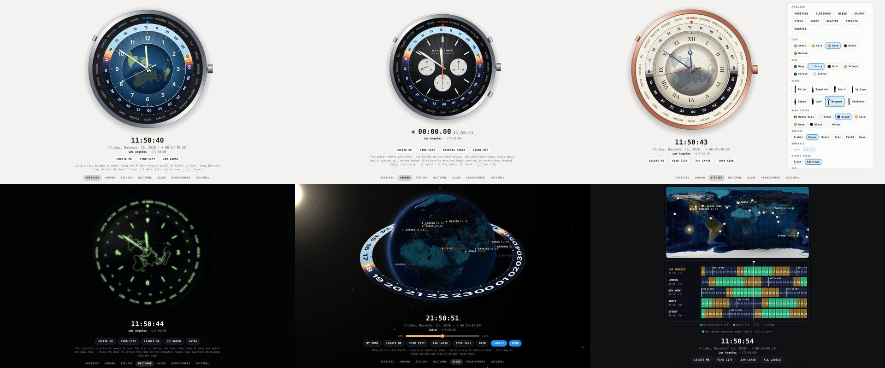

# World Timer

An interactive world-time watch for the browser: 24 cities, a 24-hour ring that tracks the sun, and a live day/night map of the Earth. No build step, no dependencies, plain HTML, CSS and JavaScript.

**Live demo:** https://rayhe.github.io/worldtimer/



## Variants

| Page | What it is |
| --- | --- |
| [`index.html`](index.html) · **Heritage** | The refined classic. Vector dial, north-polar map with a real terminator, sky-coloured hour ring. |
| [`chrono.html`](chrono.html) · **Chrono** | World-time flyback rattrapante chronograph. Top pusher starts and stops, the button in the crown splits (the steel hand stops, then catches up), the bottom pusher flies back to zero while running. |
| [`atelier.html`](atelier.html) · **Atelier** | Build your own: 5 cases, 6 dials, 8 hand sets, 7 hand finishes, 6 index styles, 4 maps, 4 movements. The configuration lives in the URL. |
| [`nocturne.html`](nocturne.html) · **Nocturne** | The watch in the dark. Your pointer is a torch that charges the lume; click the dial to strike the time on a minute repeater. |
| [`globe.html`](globe.html) · **Globe** | A real globe in WebGL: NASA imagery, city lights, atmosphere, and an hour ring fixed to the sun. VR and AR through WebXR. |
| [`planisphere.html`](planisphere.html) · **Planisphere** | A live sunlight map with a draggable multi-city timeline for finding meeting times. |
| [`worldtimer.html`](worldtimer.html) · **Original** | The first version, unchanged, still a single self-contained file. |

## How to read it

The city ring and the map are one rigid piece: each city sits on its own time-zone meridian, with east running counter-clockwise as seen from above the North Pole. The 24-hour ring is fixed to the sun, so its 12 always points at the meridian where it is noon. Read any city's hour from the numeral beside it. Changing the home city turns the Earth; the passage of time turns the ring.

Small dots between the city names are the zones that sit off the whole hour (Delhi, Kathmandu, Tehran, Adelaide and others). Daylight saving is honoured: cities move between slots as their offsets change.

## Controls (watch pages)

| Action | Pointer | Keyboard |
| --- | --- | --- |
| Make a city home | click its name or pip | `Tab` to it, `Enter` |
| Next zone east / west | pusher at 10 o'clock (east) | `→` / `←` |
| Travel in time | drag the 24-hour ring, or scroll | `↑` / `↓` one hour, `Shift` for a day |
| Turn the Earth | drag the city ring | |
| Back to now | press the crown | `N` or `Esc` |
| Back to your zone | "My zone" | `L` |
| Find a city | "Find city" | `/`, or just start typing |
| 24 hours in 10 seconds | click the dial | `T` |

Chrono adds `Space` (start/stop), `S` (split, the crown button), `F` (fly back) and `R` (fly back while running, reset when stopped); on that page the crown splits instead of returning to now. The home city, and each variant's own settings, are kept in the URL fragment so a link reproduces what you see.

## Location

Your place is worked out in two tiers:

1. **Time zone, from the device settings.** This is the default and needs no permission. The home city is that zone's city, and sunrise, sunset and the map marker use its coordinates.
2. **Precise position, only if you ask.** "Locate me" requests the browser's geolocation. The fix is rounded to about a kilometre, kept in this browser's local storage only, never put in the URL, and dropped automatically if the device's time zone changes. Press the chip again to forget it.

## Structure

```
js/core.js        virtual clock, time-zone and solar maths, city data, variant nav
js/watch.js       the SVG watch engine shared by Heritage, Chrono, Atelier and Nocturne
js/page.js        digital readout, chips, city search, keyboard, URL state
js/land.js        land outlines for the dial map
js/earth-tex.js   day, night and relief textures for Globe and Planisphere
css/base.css      shared page styles
```

Everything is a classic script, so every page also works opened straight from disk. The solar position uses low-precision almanac formulae (good to about 0.01°); time zones come from the browser's own `Intl` database.

## Notes

- Globe needs WebGL 2. The VR and AR buttons appear only where the browser reports WebXR support. The stereo render path has been exercised with a simulated headset, not on real hardware.
- Nocturne's repeater and Chrono's pusher clicks use Web Audio and only sound after a click or key press.

## Credits

- Land outlines: [Natural Earth](https://www.naturalearthdata.com/) 1:110m, public domain, via [world-atlas](https://github.com/topojson/world-atlas).
- Earth imagery: NASA Blue Marble and Earth at Night (NASA Earth Observatory / Visible Earth), packaged in the [three-globe](https://github.com/vasturiano/three-globe) examples.

## License

MIT. See [LICENSE](LICENSE).
